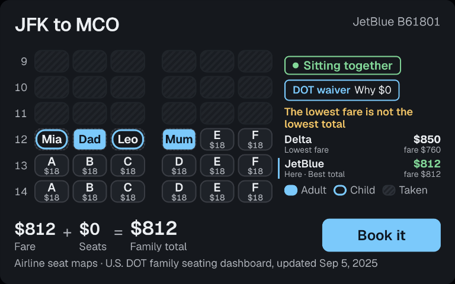
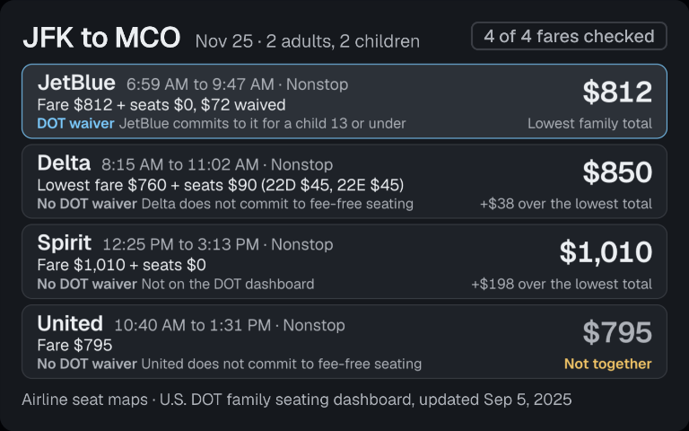
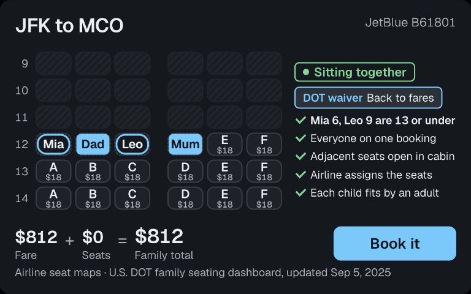
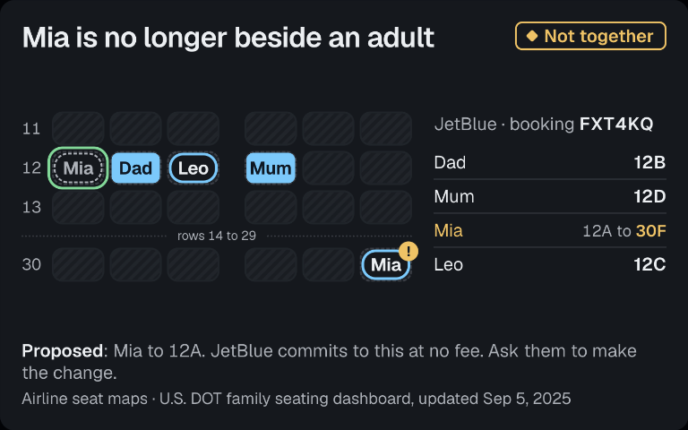

# Side by Side



**219 tests pass** (`npm test`: 191 server, 28 Echo Show client). **tools/call p50 18 ms, p95 69 ms** over the 6 timed calls of one `npm run demo` run, read from the wire panel against Alexa's 500 ms budget.

```bash
npm install
npm run demo        # fixture server + Echo Show client, no credentials
open "http://127.0.0.1:5173/?autorun=1"
```

Side by Side is an Alexa+ add-on that reads each flight's seat map and books the trip that seats the family together: on the demo search the lowest fare ($760, Delta) costs the family $850 to sit together, so JetBlue at $812 ranks first.

A parent says "find us flights to Orlando for Thanksgiving, kids next to us." Side by Side reads the seat map of each of the cheapest direct fares, ranks them by the total price of seating each child beside a parent, says how many it evaluated, shows the cabin on the Echo Show with the family's names on the seats, books the order in one reservation, with the seat fees on the bill only where the carrier charges them, and answers "are we still sitting together?" in a later session, drawing the cabin with any child the airline moved away from an adult.

## Track map

| Track item | Where it lives | Proven by |
|---|---|---|
| Self-hosted MCP server, Streamable HTTP, protocol 2025-11-25 and 2025-03-26 | `server/src/app.ts`, `server/src/mcp.ts` | `server/test/mcp.test.ts` (protocol negotiation, sessions, tools/list, tools/call) |
| MCP Apps view on the 768x480 canvas | `server/src/ui/side-by-side/`, `ui://side-by-side/seats.html` | `server/test/mcp.test.ts` (resources/read returns the 768x480 view) |
| Agent Skill, served over MCP as prompt `side-by-side` and loaded into the client's system prompt | `skills/side-by-side/SKILL.md`, `server/src/mcp.ts`, `sim/src/mcp.ts` | `server/test/mcp.test.ts` (prompts/get), `sim/test/client-skill.test.ts` (the client connects to the server and the skill reaches the model's system prompt), `sim/test/skill.test.ts` |
| Elicitation: details and a price confirm before any booking | `server/src/service.ts` (`bookTogether`) | `server/test/mcp.test.ts` (books over the wire with elicitation) |
| State across sessions | `server/src/store.ts` (SQLite) | `server/test/e2e.test.ts` (a restarted server detects the airline's seat change) |
| Amazon Bedrock as the tool-choosing model | `sim/server/llm.ts` (`openai.gpt-oss-120b` on the mantle endpoint) | `npx tsx sim/scripts/mantle-turn.ts` prints PASS |

## Screens

| Ranked by family total | Why $0 | The airline moved Mia |
|---|---|---|
|  |  |  |

## What is in the repo

| Path | What it is |
|---|---|
| `server/` | MCP server, Streamable HTTP at `/mcp`, protocol 2025-11-25 and 2025-03-26, built on `@modelcontextprotocol/sdk` and `@modelcontextprotocol/ext-apps` |
| `server/src/solver.ts` | Deterministic seating solver. Plain code, no model. Children 13 and under sit beside an adult, nobody under 15 in an exit row |
| `server/policy/dot-family-seating.json` | U.S. DOT Airline Family Seating Dashboard table with its source URL, read date and the dashboard's own update date. `server/src/dot.ts` validates it at startup and refuses a file that lacks any of them; a carrier not in it never counts as fee-free |
| `server/src/tools/` | Six tools: `save_family`, `find_family_flights`, `show_seats`, `move_traveler`, `book_together`, `still_together` |
| `server/src/ui/side-by-side/` | The MCP Apps view (`ui://side-by-side/seats.html`), 768x480 |
| `server/src/lint/` | Tool description lint for poisoned-description patterns |
| `sim/` | Side by Side on Echo Show: a real MCP client with the MCP Apps host bridge, Web Speech voice, an LLM tool-choosing loop, and a wire panel showing the MCP handshake (protocol version, tools/list) and every tools/call with its latency in ms |
| `skills/side-by-side/SKILL.md` | Agent Skill: voice rules, tool routing, seating policy. The server serves it as MCP prompt `side-by-side` and the Echo Show client loads it into its system prompt at connect |
| `spikes/seats/` | Measurement script for the together-price and latency numbers |

## Run it

Requires Node 24 or newer.

```bash
npm install

# 1. The MCP server. Put a Duffel test token (duffel_test_...) in DUFFEL_ACCESS_TOKEN first.
npm run start -w server        # http://127.0.0.1:8790/mcp, health at /health

# 2. Side by Side on Echo Show (needs one LLM credential in the environment, see below)
npm run dev -w sim             # http://127.0.0.1:5173
```

`npm run fixture -w server` serves the same tools over the same transport on the same port, backed by an in-memory Duffel service that enforces Duffel's order rules (payment equals fare plus seat services, services exist and are unused, expired offers are refused). It is the quickest way to run the whole journey. Next to the device, Demo day controls let the airline move a child after booking.

## Demo run

```bash
npm run demo              # starts the fixture server and the Echo Show client, prints the URL, needs no credentials
npm run demo -- --open    # also opens it in the deepsurge browser profile through bhn
```

`http://127.0.0.1:5173/?autorun=1` plays the whole journey in about 80 seconds. The parent's lines appear as heard, Alexa answers by voice and caption, and the wire panel fills with `initialize` (negotiated protocol version), `tools/list`, `prompts/get` (the Agent Skill) and every `tools/call` with its latency in ms:

1. `save_family`: Dad 40, Mum 38, Mia 6, Leo 9.
2. `find_family_flights` JFK to MCO: the header says how many fares were checked, and every flight card shows its base fare, each seat fee, the DOT fee waiver with its reason, and the family total.
3. `show_seats` on JetBlue: Delta has the lowest fare ($760) and costs $850 for the family to sit together; JetBlue is $812 fare and $0 in seat fees under the DOT commitment, $812 for the family. Both sit side by side on the seat map, and "Why $0" lists the children the commitment covers (Mia 6, Leo 9) and each DOT condition the booking meets.
4. `show_seats` on United: no two open seats are side by side, so the screen says so and offers the flights that work.
5. `book_together`: the confirmation form, then the booking reference.
6. Demo day: the airline seats the family, `still_together` says yes and draws them in row 12; the airline moves Mia to 30F, and `still_together` draws the cabin with Mia flagged at 30F, a ghost at her old seat and the proposed seat outlined.

Flights are picked by carrier, never by position, and the fixture's offers expire 30 minutes after each search on the real clock, so the run reads the same on every start and on any day. Without the script, the same journey works by voice or typing.

The Echo Show client's tool-choosing model is configured by environment variable names only: `ANTHROPIC_API_KEY`, or `OPENAI_API_KEY` / `OPENROUTER_API_KEY` (optionally `OPENAI_BASE_URL`), or `AWS_BEARER_TOKEN_BEDROCK` for Amazon Bedrock through its OpenAI-compatible endpoint (`openai.gpt-oss-120b` with tool calling, the default whenever that variable is set; `npx tsx sim/scripts/mantle-turn.ts` runs a full save_family then find_family_flights turn against the fixture server), or `AWS_PROFILE` with `AWS_REGION` for Bedrock Converse. `LLM_PROVIDER` and `LLM_MODEL` pick one explicitly. Keys stay in the Vite server process.

## Checks

```bash
npm test                          # server integration, solver, service, DOT table and lint tests, plus the Echo Show client's wire, spoken-text, skill and demo-plan tests
node scripts/readme-images.mjs    # every image the README links exists
npm run lint:tools -w server      # exits 1 on a poisoned tool description
npm run lint:tools -w server -- --plant   # plants one, exits 1
SPIKE_RUNS=5 npx tsx --env-file=.env spikes/seats/spike.ts   # live: together-price table, first-answer latency and time to completion per tool, over 5 runs
```

## Answers inside Alexa's 500 ms

Every tool answers in about 200 ms against live Duffel, and the airline's seconds land in the background. Measured over 5 live runs (`spikes/seats/results.json`):

| Tool | First answer p50 / p95 | Work behind it completes |
|---|---|---|
| `find_family_flights` | 204 / 213 ms | ranking complete in 2.2 s p50, 3.7 s p95 |
| `book_together` | 209 / 217 ms | reference issued in 2.8 s p50, 4.3 s p95 |
| `still_together` | 204 / 205 ms | fresh reading in 0.71 s |
| `save_family`, `show_seats`, `move_traveler` | 3 ms or less p50, 10 ms p95 | |

- Seat maps for the cheapest fares are read in parallel under a concurrency cap while the search runs. The first answer carries the best ranked offers that are ready; the Echo Show fills in as the rest land, and asking again returns the same search.
- `book_together` answers with a booking state and finishes the order in the background. Asking again returns that booking, never a second order. The live seat map is read once more after the family says yes, and a total that moved since they agreed is never charged.
- `still_together` returns the last reading with its age while a fresh one is read, and every call in flight shares one read of the order.
- A cached seat map prices only while its offer is unexpired and younger than five minutes.

## How the numbers are made

- Together-price: fare plus the cheapest seat fees that put every child beside an adult on the flight's live seat map, or no seat fees where the carrier is on the DOT fee-free list and adjacent seats exist. A carrier that is not on the DOT list pays every seat fee.
- Evaluated: the search reads the seat map of up to the 10 cheapest direct fares. The list states how many were evaluated and whether more exist.
- The seating answer is computed by `solver.ts` from the Duffel seat map. The model only chooses which tool to call.
- Every flight card breaks its family total into base fare, each seat fee and the DOT waiver. "Why $0" on the seat map and the booking lists the children the commitment covers and each dashboard condition the booking meets (`server/src/ui/side-by-side/audit.ts`, `server/test/audit.test.ts`).
- A child is never booked without an adult beside them. When the open seats cannot do that, the answer is "no adjacent seats on this flight" with the flights of the same search that can.
- Spoken replies are stripped of markdown in code before they are captioned or spoken.
